# KID — architecture (v2)

The pipeline the brief asks for:

**voice input → speech recognition → intent interpretation → validated parameter proposal → audition → explicit approval → deterministic DSP execution.**

Five of the seven stages exist in the plug-in today. One is a UI change (explicit approval in the KID screen). One is new engineering (audition).

## 1. Pipeline

```mermaid
flowchart LR
  A["Hold to talk<br/>(push-to-talk only)"] --> B["CommandMic<br/>separate input device<br/>private buffer, discarded"]
  B --> C["Recogniser<br/>whisper.cpp, local<br/>background thread"]
  C --> D["kid::parse<br/>words → IntentFrame"]
  T["Typed text / chips"] --> D
  D --> E["kid::Director<br/>direction + memory<br/>(+ analysis facts)"]
  E --> F["Validator<br/>allowlist + real ranges<br/>finite values only"]
  F --> G["Proposal rows<br/>current → proposed + reason<br/>per-row ticks"]
  G -->|Listen: Proposal| H["Audition<br/>processor preview state<br/>(NEW)"]
  G -->|Apply| I["applyParameterChanges<br/>host gestures · automation<br/>one undo step"]
  H -->|Apply| I
  H -->|Current / Cancel / ×| G
  I --> J["processChunk<br/>deterministic DSP, fixed order 1→17"]
```



| Stage | Code today | Thread | Status |
|---|---|---|---|
| Push-to-talk capture | `Kid/KidSpeech.h` `CommandMic`: the system default input (never ASIO), opened only while held; audio goes to a private buffer, then is discarded; never reaches `processBlock`, the analyser, display taps or saved state | Device callback → private buffer | **Exists** |
| Speech recognition | `Recogniser`: whisper.cpp; results return on the message thread. `SpeechModel`: `ggml-base.en.bin`, opt-in download, SHA-1 `137c4040…` verified before loading | Background thread | **Exists** |
| Intent interpretation | `kid::parse (text) → IntentFrame` (ops per dimension, scale, locks, flags, role, profile, tune, cleanLevel, buildMix, ask) | Message thread | **Exists** (vocabulary additions are new: `INTENT_PARAMETER_MAP.md`) |
| Proposal with memory | `kid::Director::begin / respond / plan / setFoundation`. Relative to the starting sound, so "less" reshapes rather than piles up | Message thread | **Exists** |
| Validation | `Director::isAllowed` (no Gain, Mix, limiter, Bypass; key/scale only from a reliable estimate); range lookup; finite check; refused ids reported (`refused()`) | Message thread | **Exists** |
| Selection and hand edits | `setSelected`, `noteManualEdit`, `selectedChanges` | Message thread | **Exists in the engine.** `KidPanel` currently applies the whole plan immediately (`applyPlan`) → **UI change** |
| Audition | — | Message → audio handoff | **NEW-ENG** (§3) |
| Execution | `GlitchKidProcessor::applyParameterChanges`: the normal parameter path (host gestures, automation, saved state) | Message thread → APVTS → audio thread reads atomics | **Exists** |

## 2. Invariants (must hold in every implementation)
1. **Nothing in the KID path runs on the audio thread,** and nothing writes audio-thread memory directly. The only route to DSP is APVTS parameters, plus (new) the preview handoff in §3.
2. **Every value that reaches the processor passes the validator:**
   - an allowed id;
   - a value inside the parameter's real range;
   - a finite number.
   Free-form values from any interpreter are never accepted.
3. **No change is applied without an explicit Apply.** Opening, closing, cancelling and auditioning never change the parameter tree.
4. **Apply is one undo step,** labelled, and restores exactly.
5. **The command mic is push-to-talk only and separate from the vocal input.** Command audio is never stored or sent.
6. **Deterministic.** The same words, the same starting sound and the same analysis facts give the same proposal. That makes the engine unit-testable; today's tests already cover it.

## 3. Audition (new engineering)

**Recommended: a processor-side preview snapshot.**

```
message thread                               audio thread (processChunk)
──────────────                               ───────────────────────────
target = start + ticked rows                  if (previewActive.load())
write into previewBuf[1 - live]                   read values from previewBuf[live]
live.store (1 - live)  ── atomic handoff ──▶  else read the APVTS atomics (as today)
previewActive.store (true / false)             crossfade 20 ms on enter/exit (like Bypass)
```

- **No allocation or locks on the audio thread.** Buffers are pre-allocated, fixed-size arrays indexed by parameter.
- **The parameter tree, the host's automation and the host's undo are untouched** during the audition. Leaving restores exactly, because nothing was written.
- **The same mechanism serves Scene Preview.**
- **Open decision: latency-changing stages.** Tune ≈31 ms, Formant ≈21 ms, Harmony, and the Limiter ≈1.5 ms change the host latency. The options are:
  - keep those rows out of audition, with a label;
  - report the worst case while auditioning;
  - or accept a latency change.

  See `IMPLEMENTATION_PLAN.md` §2.
- **Tests:**
  - the APVTS values are identical before, during and after;
  - the output equals an offline render of the target;
  - there is no allocation (the existing allocation-guard pattern);
  - automation arriving during an audition is honoured.

The alternative, swapping real parameters and restoring them afterwards, is simpler but visible to the host (automation lanes, "project modified", the host's undo). It also fails unsafe if the plug-in crashes mid-audition. Not recommended.

## 4. Build My Mix uses the same proposal path

`automode::buildMix` (`AutoMode/MixEngine.cpp`):
- builds the target as Factory Default + the profile's overrides;
- scales echo, Dimension, Doubler and saturation by intensity;
- keeps the 22 user-owned parameters and Bypass;
- returns per-change from / to / reason.

v2 routes it through the same review, audition and apply as KID. The editor's `runBuild` currently calls `applyPreset ("Built: …")` directly; v2 would show the review instead.

## 5. If a cloud model is ever considered (not proposed now)

**Not part of this design.** If a future product decision adds one:
- **It replaces only `kid::parse`.** Its output must be the existing `IntentFrame` schema (dimensions, scale, locks, role…), **never parameter values**. The Director and the validator stay authoritative, so every invariant in §2 still holds.
- **Opt-in, per user,** with a clear statement of what is sent: the transcript text only, never audio. It must work offline by falling back to the local rules.
- **The transcript is the user's own speech.** It is still treated as untrusted input to the interpreter: schema-validated, with length limits, and no tool access.
- **Costs and privacy:** `PRIVACY_AND_COSTS.md`.

## 6. Where each piece lives in the v2 UI

| Pipeline stage | v2 UI |
|---|---|
| Push-to-talk | The **HOLD TO TALK** button on the Booth; the small mic in the drawer; holding **K** anywhere |
| Recognised text | The *You said (transcribed on this computer)* bubble |
| Interpretation | KID's line: *Heard: …*, *Keeping: …*, *Kept as yours: …*, NEW WORDS flag |
| Proposal | The review component (grouped by stage, ticks, tags) |
| Audition | Listen: Current / Proposal; the Booth chip *PROPOSAL, NOT APPLIED*; the chain strip shows the proposal |
| Approval | **Apply n changes** |
| Execution and reversal | *Applied n changes* with **Undo**; the top-bar Undo |

## 7. What the prototype simulates
- **Recognition:** what KID "hears" is chosen from a list on the prototype page.
- **Timing:** the delays of each state.
- **Interpretation:** a small rule set modelled on `KidDirector`. Its numbers are similar in spirit, not identical. Production values come from `KidDirector::decide`.
- **Measurements:** those behind "Help me improve it" and the Build My Mix "fitted" rows.
